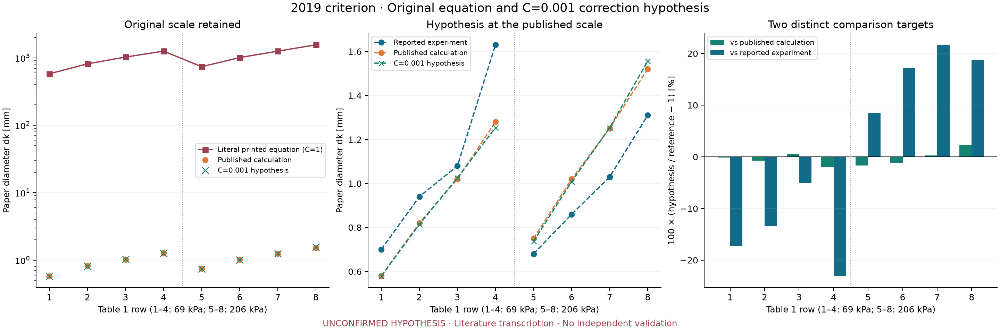

# sprinkler1d

**Air entrainment → radial film → droplets → rainfall. An auditable reduced-order engineering workflow.**

Python 3.11+ · MIT · NumPy / SciPy · CLI + Python API · SI units

> **Research demonstrator, not a validated digital twin.** Grounded in publications co-authored by Dmitry Shakhrai (2017–2021), with a traceable literature audit and explicitly separate demonstration closures. Dissertation files, raw measurements and the earlier sprinkler1d implementation remain unavailable. Published results are not presented as validation of this new solver.

## Why this belongs in an engineering portfolio

This project turns a multiphysics research question into an inspectable computational tool: conservation-law modeling, replaceable empirical closures, inverse design, parameter identification, uncertainty scenarios, CFD exchange contracts and automated verification.

For **CAE / CFD** it demonstrates model hierarchy and boundary-data handling; for **multiphysics**, conservative coupling between fluid transport and particle trajectories. For **thermal engineering**, the transferable skills are balance formulation and parameter estimation—heat transfer is not implemented here. For **robotics-adjacent** applications, it offers a foundation for spray footprint models and offline operating-point selection; actuator dynamics, feedback control and ROS integration are future work.

The scientific value of a future validated version would be a measured geometry–entrainment–film–drop relationship and its engineering synthesis. This release makes **no claim of novel physics or experimentally established accuracy**.

## Research behind the software

The research programme develops adjustable air-induction sprinkler heads and their hydraulic control. The repository connects published work to executable engineering checks:

| Publication | Contribution used here |
|---|---|
| Kravtsov, Shakhrai & Popko, **Agropanorama 5 (2017), 9–15** — [adjustable sprinkler](https://rep.bsatu.by/handle/doc/2800) | Device concept, bench observables and competing hydraulic/energy objectives |
| Basarevsky, Kravtsov & Shakhrai, **57(2) (2019), 230–237** — [drop similarity criterion](https://doi.org/10.29235/1817-7204-2019-57-2-230-237) | Original Eqs. 18–20 preserved alongside an explicitly unconfirmed C=0.001 correction hypothesis; all eight Table 1 rows compared |
| Kravtsov & Shakhrai, **Agropanorama 1 (2021), 14–18** — [controlled sprinkler systems](https://rep.bsatu.by/handle/doc/12545) | Eqs. 1–6 for entrainment, mixture velocity and multiple-head flow totals; a basis for future automation interfaces |

**The 2019 audit retains both variants.** The literal printed equation gives approximately 1000 times the tabulated diameter. A separate **unconfirmed correction hypothesis**, with dimensionless C=0.001 fixed rather than fitted, gives 1.1109% mean absolute percentage error against the paper's calculated column (maximum 2.3361%). Its error against the reported experimental column is larger: 15.6113% MAPE. Reproducing the published calculation is not independent experimental validation. See the [complete eight-row comparison](docs/literature/comparison.md) and [worked unit check](docs/literature.md#unit-check-and-c0001-hypothesis).

The original function and source table remain intact. The hypothesis is excluded from the forward/inverse solver and does not establish a confirmed erratum. The published diameter dk is not assumed to equal d32. The 2021 paper describes immediate breakup after the deflector for aerated operation; a continuous-film regime therefore requires regime-specific verification.

    python examples/literature_audit.py --output artifacts/literature

The audit exports JSON, CSV, a Markdown table, PNG and vector SVG. Its rounding intervals describe printed precision, not measurement uncertainty.

Read the [eight-source research map and equation audit](docs/literature.md), [machine-readable source register](docs/references.json) and [BibTeX bibliography](docs/references.bib). Full article PDFs are linked at their publishers rather than redistributed under MIT.

## Get running

From the repository root:

    python -m venv .venv
    # Linux/macOS:
    source .venv/bin/activate
    # Windows PowerShell instead:
    # .\.venv\Scripts\Activate.ps1
    python -m pip install ".[dev]"
    pytest
    sprinkler1d run --config examples/demo.json --output artifacts/demo

Open artifacts/demo/report.html in a browser. It embeds the figure and includes a configuration hash, package versions, numerical settings, residuals and uncertainty assumptions. CSV, JSON, PNG and SVG outputs are also written.

For the exact locally tested dependency versions:

    python -m pip install -c constraints-tested.txt ".[dev]"

The constraints record one tested Windows / Python 3.12 environment, not a guarantee that every version has wheels for every Python release. CI separately exercises the supported Python matrix with the package's declared version ranges.

## Engineering workflows

    # Dimensional audit
    sprinkler1d dimensions

    # Synthetic recovery: 45 calibration + 15 holdout runs
    python examples/generate_demo_data.py
    sprinkler1d calibrate datasets/demo/breakup_synthetic.csv --output artifacts/fit.json

    # Choose pressure and nozzle diameter for two engineering targets
    sprinkler1d synthesize --config examples/demo.json --flow-l-min 16 --d32-mm 0.55 --output artifacts/design.json

    # Assumed spreads, not experimentally inferred confidence intervals
    sprinkler1d uncertainty --config examples/demo.json --samples 200 --seed 42 --output artifacts/uncertainty.json

    # After exporting a real CFD section table in the documented format
    sprinkler1d compare-cfd --config examples/demo.json --csv path/to/film.csv --output artifacts/cfd-comparison.json

Synthesis uses bounded multistart least squares. It reports convergence, target errors, bounds and the full case. An unmet 1% target tolerance returns exit code 2. This is a feasibility search inside a design box, not a global optimum or manufacturing recommendation. Save the returned case object as JSON to simulate the selected design.

    from sprinkler1d import Case, simulate
    result = simulate(Case(pressure_pa=200_000), classes=128)
    print(result.summary())

## Architecture

See the [architecture diagram](docs/architecture.md).

| Location | Responsibility |
|---|---|
| src/sprinkler1d/ | Physical blocks, synthesis, identification, uncertainty, CFD and CLI |
| tests/ | Analytic limits, balances, invalid inputs, refinement and end-to-end workflows |
| examples/ | Full SI case, Python example and seeded synthetic data generator |
| datasets/demo/ | Synthetic data and generator provenance |
| datasets/literature/ | Attributed published table, separate from raw measurements and synthetic data |
| datasets/validation/ | Empty measurement templates and evidence requirements |
| docs/demo/ | Reference report, figures and machine-readable outputs |
| docs/methodology_ru.md | Russian scientific methodology and equations |
| docs/verification-matrix.csv | Equation-by-equation evidence and acceptance gates |
| docs/source-audit.md | Available context and specific missing sources |
| .github/workflows/ci.yml | Linux/Windows test and report build matrix |

## Verification is not validation

Automated checks cover the momentum residual, liquid continuity, film mechanical-energy identity, dimensional consistency, exact vacuum projectile solution, zero-friction film limit, choked-flow limits, discrete Sauter mean, rainfall volume conservation, numerical refinement and synthetic parameter recovery.

The hydraulic input power bounds the outlet kinetic power. **This is not a full gas/liquid energy equation**: slip, compression work and detailed pressure recovery are omitted. The mixture is evaluated at ambient outlet conditions. Breakup, gas retention, friction and diameter distribution are uncalibrated.

Validated results are intentionally absent. Experimental CSV input produces EXPERIMENTAL_FIT_REQUIRES_REVIEW, never automatic validation. Read the [verification matrix](docs/verification-matrix.csv), [limits](docs/limitations.md) and [source audit](docs/source-audit.md).

## CFD and scientific extension

Every forward report exports cfd_boundary.json. A section CSV can be compared against the film solver. This is a tested data interface; no OpenFOAM, Fluent or other CFD simulation is claimed to have run. See [CFD contract](docs/cfd.md).

The current isothermal, still-air model is small enough for parameter sweeps and design exploration. Coupled thermodynamics, non-axisymmetric ports, instability eigenvalue analysis, measured size distributions and field overlap uniformity belong in later evidence-backed releases.

## Reproducibility and contribution

Run ruff check ., pytest and python -m build before proposing changes. Add analytic or conservation checks for new physics and label every dataset by provenance. Numerical tolerances are not device-accuracy tolerances. Never use synthetic recovery as an experimental accuracy claim.

See [roadmap](docs/roadmap.md), [publication commands](PUBLISH.md), [data contract](datasets/README.md) and [local verification record](docs/local-verification.md).

## References and licensing

The air-orifice treatment uses standard ideal-gas relations; [NASA Glenn's choking explanation](https://www.grc.nasa.gov/www/k-12/BGP/mflchk.html) gives the physical background. Solvers use the official [SciPy solve_ivp](https://docs.scipy.org/doc/scipy/reference/generated/scipy.integrate.solve_ivp.html) and [least_squares](https://docs.scipy.org/doc/scipy/reference/generated/scipy.optimize.least_squares.html) interfaces. These references support building blocks, not sprinkler accuracy.

New code, documentation and synthetic examples are licensed under [MIT](LICENSE). Third-party articles and future experimental datasets require separate rights/provenance review and are not silently relicensed. Cite software by version and commit until an archival DOI exists.
