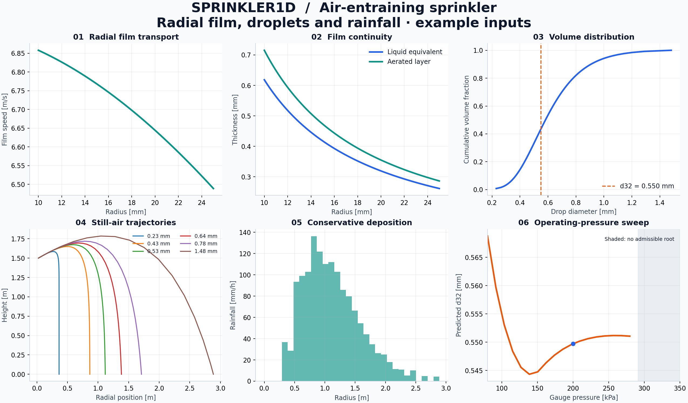

# sprinkler1d

**A reduced-order model of an air-induction sprinkler: air entrainment, radial film flow, droplet breakup and rainfall distribution.**

Python 3.11+ · MIT · NumPy / SciPy · CLI + Python API · SI units

I’m developing sprinkler1d to explore how nozzle geometry, water pressure and air entrainment affect droplet size and the rainfall footprint. The calculation follows the flow through an ejector, a radial film on the deflector, droplet formation and flight to the ground.

The Python package includes a forward solver, pressure and nozzle selection for target flow and drop size, breakup-parameter fitting, parameter sweeps and HTML reports. Intermediate flow states and balance residuals are available through the Python API and exported files.

The current model uses prescribed geometry and empirical closure coefficients. The included examples use synthetic inputs; calibration against raw measurements is still pending. The [model assumptions](docs/limitations.md) describe the supported calculations and their limits.

## Background

This project continues my work on adjustable sprinkler heads with air induction. Publications I co-authored in 2017–2021 provide the device background and several relations examined in the code:

| Publication | Contribution used here |
|---|---|
| Kravtsov, Shakhrai & Popko, **Agropanorama 5 (2017), 9–15** — [adjustable sprinkler](https://rep.bsatu.by/handle/doc/2800) | Device concept, bench observables and competing hydraulic/energy objectives |
| Basarevsky, Kravtsov & Shakhrai, **57(2) (2019), 230–237** — [drop similarity criterion](https://doi.org/10.29235/1817-7204-2019-57-2-230-237) | Eqs. 18–20 and an eight-row comparison of the printed equation and a C=0.001 correction hypothesis with Table 1 |
| Kravtsov & Shakhrai, **Agropanorama 1 (2021), 14–18** — [controlled sprinkler systems](https://rep.bsatu.by/handle/doc/12545) | Eqs. 1–6 for entrainment, mixture velocity and multiple-head flow totals |

The 2019 equation gives diameters approximately 1000 times those in its published table. I keep the printed relation and a separate C=0.001 correction hypothesis in the [eight-row comparison](docs/literature/comparison.md). Both remain outside the forward solver while the discrepancy is unresolved.

The [literature notes](docs/literature.md) cover all eight sources, the unit check and the physical regimes described in the papers. Publication metadata is available in [JSON](docs/references.json) and [BibTeX](docs/references.bib). Full article PDFs are linked at their publishers.

## CFD v0.4 — patent-informed ejector geometry

The [CFD v0.4 module](cfd/patent_v04/README.md) generates configurable OpenFOAM.com `interFoam` cases for a thin-diaphragm water nozzle, suction chamber and mixing throat, including open/closed annular-air variants. An experimental Gmsh 3D geometry includes a lateral air inlet. The module references patents BY 22927 and BY 22747 and keeps unmeasured dimensions as explicit initial parameters; neither the new OpenFOAM mesh nor its 3D prototype has yet been solver-validated.

## Get running

From the repository root:

    python -m venv .venv
    # Linux/macOS:
    source .venv/bin/activate
    # Windows PowerShell instead:
    # .\.venv\Scripts\Activate.ps1
    python -m pip install ".[dev]"
    pytest
    sprinkler1d run --config examples/demo.json --output artifacts/demo

Open artifacts/demo/report.html in a browser. It embeds the figure and includes a configuration hash, package versions, numerical settings, residuals and uncertainty assumptions. CSV, JSON, PNG and SVG outputs are also written.

For the dependency versions recorded in the [local verification record](docs/local-verification.md):

    python -m pip install -c constraints-tested.txt ".[dev]"

The constraints record a Windows / Python 3.12 environment. CI exercises the supported Python matrix with the package's declared version ranges.

## Calculations

    # Dimensional audit
    sprinkler1d dimensions

    # Synthetic recovery: 45 calibration + 15 holdout runs
    python examples/generate_demo_data.py
    sprinkler1d calibrate datasets/demo/breakup_synthetic.csv --output artifacts/fit.json

    # Choose pressure and nozzle diameter for two engineering targets
    sprinkler1d synthesize --config examples/demo.json --flow-l-min 16 --d32-mm 0.55 --output artifacts/design.json

    # Assumed spreads, not experimentally inferred confidence intervals
    sprinkler1d uncertainty --config examples/demo.json --samples 200 --seed 42 --output artifacts/uncertainty.json

    # After exporting a real CFD section table in the documented format
    sprinkler1d compare-cfd --config examples/demo.json --csv path/to/film.csv --output artifacts/cfd-comparison.json

Synthesis uses bounded multistart least squares. It reports convergence, target errors, bounds and the full case. An unmet 1% target tolerance returns exit code 2. This is a feasibility search inside a design box, not a global optimum or manufacturing recommendation. Save the returned case object as JSON to simulate the selected design.

    from sprinkler1d import Case, simulate
    result = simulate(Case(pressure_pa=200_000), classes=128)
    print(result.summary())

## Architecture

See the [architecture diagram](docs/architecture.md).

| Location | Responsibility |
|---|---|
| src/sprinkler1d/ | Physical blocks, synthesis, identification, uncertainty, CFD and CLI |
| tests/ | Analytic limits, balances, invalid inputs, refinement and end-to-end workflows |
| examples/ | Full SI case, Python example and seeded synthetic data generator |
| datasets/demo/ | Synthetic data and generator provenance |
| datasets/literature/ | Attributed published table, separate from raw measurements and synthetic data |
| datasets/validation/ | Empty measurement templates and evidence requirements |
| docs/demo/ | Reference report, figures and machine-readable outputs |
| docs/methodology_ru.md | Model equations and assumptions in Russian |
| docs/verification-matrix.csv | Equation-by-equation evidence and acceptance gates |
| docs/source-audit.md | Source coverage and data needed for calibration |
| .github/workflows/ci.yml | Linux/Windows test and report build matrix |

## Model checks and calibration

Automated checks cover the momentum residual, liquid continuity, film mechanical-energy identity, dimensional consistency, exact vacuum projectile solution, zero-friction film limit, choked-flow limits, discrete Sauter mean, rainfall volume conservation, numerical refinement and synthetic parameter recovery.

The hydraulic input power bounds the outlet kinetic power. **This is not a full gas/liquid energy equation**: slip, compression work and detailed pressure recovery are omitted. The mixture is evaluated at ambient outlet conditions. Breakup, gas retention, friction and diameter distribution are uncalibrated.

Experimental calibration is pending. Fits to experimental CSV data receive the status `EXPERIMENTAL_FIT_REQUIRES_REVIEW`; the fit report includes residuals and holdout metrics for review. See the [verification matrix](docs/verification-matrix.csv), [model limits](docs/limitations.md) and [source coverage](docs/source-audit.md).

## CFD interface and next steps

Every forward report exports `cfd_boundary.json` with flow and outlet conditions. The `compare-cfd` command compares an external section CSV against the film solution. CFD cases are run separately; the [CFD interface](docs/cfd.md) documents boundary quantities, coordinates and section columns.

Next I plan to add measured geometry, identify the entrainment and film coefficients, and compare predicted droplet distributions with independent measurements. Wind and overlapping sprinkler footprints are further extensions. See the [roadmap](docs/roadmap.md).

## Reproducibility and contribution

Run `ruff check .`, `pytest` and `python -m build` before proposing changes. Changes to physical models need analytic or conservation checks. Record the origin of each dataset and distinguish numerical residuals, synthetic recovery errors and errors against measurements.

See [roadmap](docs/roadmap.md), [publication commands](PUBLISH.md), [data contract](datasets/README.md) and [local verification record](docs/local-verification.md).

## References and licensing

The air-orifice treatment uses standard ideal-gas relations; [NASA Glenn's choking explanation](https://www.grc.nasa.gov/www/k-12/BGP/mflchk.html) gives the physical background. Solvers use the official [SciPy solve_ivp](https://docs.scipy.org/doc/scipy/reference/generated/scipy.integrate.solve_ivp.html) and [least_squares](https://docs.scipy.org/doc/scipy/reference/generated/scipy.optimize.least_squares.html) interfaces. The equations and their use in each block are documented in the [methodology](docs/methodology_ru.md).

New code, documentation and synthetic examples are licensed under [MIT](LICENSE). Third-party articles and experimental datasets retain their respective licenses. Cite software by version and commit until an archival DOI exists.
