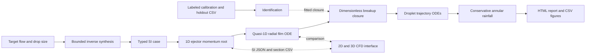

# Model architecture

Block dataclasses expose intermediate states; input Case objects are immutable. The solver composes the blocks without hidden global calibration state. Report generation is downstream of the physical solution.
