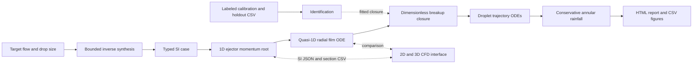

# Model architecture

Block dataclasses expose intermediate states; input Case objects are immutable. The solver composes the blocks without hidden global calibration state. Report generation is downstream of the physical solution.

The source-specific literature.py module is deliberately outside the forward chain. It exposes the unchanged 2019 printed equation, the separately named criterion_2019_c001_hypothesis API, and the 2021 flow-accounting contract. The correction hypothesis has a fixed dimensionless C=0.001 and returns SI metres. Both 2019 variants and the purely kinematic control relations remain separate from the solver's physical blocks.
